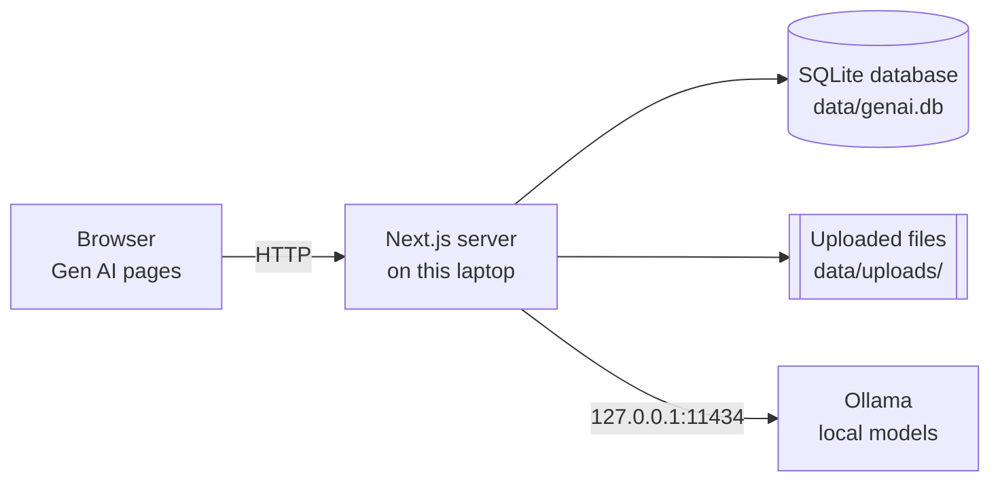

# Gen AI — Your Personal AI Study Assistant

An AI study assistant for university students that learns from **your own course materials** and runs on a **local AI model (Ollama)**. Upload a lecture, ask questions and get answers that cite the exact page or slide, generate study notes, and practise with quizzes. No paid API key is needed, and your files never leave your computer.

## Assignment: "AI with local knowledge"

**Topic:** using a local large language model (Ollama) together with our own course materials, stored and searched on our own laptop, to help university students study. The "local knowledge" is the student's uploaded documents: they are extracted, split into passages, indexed and searched locally, and the most relevant passages are given to the local model so its answers are grounded in the material and cite their sources (retrieval-augmented generation, RAG).

### Team

| Name | Nickname | Student ID |
| ---- | -------- | ---------- |
| _Name 1_ | _Nickname_ | _ID_ |
| _Name 2_ | _Nickname_ | _ID_ |
| _Name 3 (if any)_ | _Nickname_ | _ID_ |

> Student IDs are also submitted to our professor directly; decide as a team whether to list them in this public README.

## Features

| | Feature | What it does |
|---|---|---|
| ✅ | **Local AI connection** | Detects your installed Ollama models, shows a live status (connected, model loading, generating, not running, model missing), and lets you pick models in Settings. |
| ✅ | **Study materials** | Upload PDF, Word (.docx), PowerPoint (.pptx), .txt/.md, or paste notes. Drag and drop, courses, rename, delete, view the extracted text page by page. |
| ✅ | **Local knowledge retrieval** | Passages are indexed for keyword search (SQLite FTS5, works for Thai) and semantic search (local embeddings). Hybrid ranking picks the best passages for each question. |
| ✅ | **AI Tutor** | Grounded answers with highlighted citations like **S1** that link to the exact page; levels (beginner / standard / exam-ready); English or Thai; follow-up buttons; saved conversations; retry after errors. |
| ✅ | **Summaries & notes** | Quick overview, detailed summary, exam notes, beginner explanation, topic breakdown. Long lectures are summarized in parts and combined. Notes are saved and can be renamed, copied, downloaded or deleted. |
| ✅ | **Practice quizzes** | Multiple choice, true/false and short answer from your materials. Every generated question is validated; short answers are graded by the local model and labelled as AI suggestions. Scores come from your real answers. |
| ✅ | **Flashcards** | Flip through any quiz as flashcards and mark cards for review. |
| ✅ | **Dashboard & library** | Recent materials, notes, real quiz results, courses, and a searchable library of everything you've saved. |
| ✅ | **Streaming-style answers** | Answers appear as the model writes them, with a Stop button. |
| ◻️ | Polished mobile layout | Works on phones (no broken layouts), but is designed mainly for laptop screens. |

## How it works



All AI calls go **browser → Gen AI server → Ollama** on the same computer. The browser never talks to Ollama directly, and nothing is sent to a cloud AI service.

### How "local knowledge" works

1. **Extraction** — text is read locally: per page (PDF), per slide including speaker notes (PPTX), or per heading section (Word, Markdown). Scanned/image-only pages and garbled Thai PDF fonts are detected and reported instead of being indexed as junk.
2. **Chunking** — text is split into ~450-token passages with overlap, at sentence and word boundaries found with `Intl.Segmenter` (Thai has no spaces between words). Every passage keeps the page/slide/section it came from.
3. **Indexing** — passages go into a SQLite FTS5 keyword index (trigram tokenizer, so Thai is searchable) and, if an embedding model is installed, are embedded with Ollama's `/api/embed` and stored as vectors in SQLite.
4. **Retrieval** — each question is searched with keywords and vectors; results are merged with reciprocal-rank fusion. Without an embedding model the app still works with keyword search.
5. **Grounded generation** — the best passages are labelled `[S1]`, `[S2]`… and sent to the chat model with the question and recent conversation, sized to fit the context window (`num_ctx` is always set explicitly).
6. **Citations** — the model cites labels; the app keeps only labels it actually supplied and shows each source with its real page number from stored metadata. Page numbers are never taken from the model.

## Requirements

- **Node.js 22.13 or newer** (22 LTS or 24 LTS) — https://nodejs.org
- **Ollama** — https://ollama.com, with at least one chat model installed
- Windows, macOS or Linux. About 300 MB of disk for the app; models need their own space.

Recommended models (check sizes on ollama.com before downloading):

| Purpose | Model | Notes |
|---|---|---|
| Chat (what you have now) | `gemma3:1b` | Fast, but weak at long explanations, Thai, and quiz JSON. |
| Chat (better) | `gemma3:4b` | Good step up if your laptop has 8 GB+ RAM. |
| Embeddings (optional) | `qwen3-embedding:0.6b` | Multilingual (English + Thai). Turns on semantic search. |

Gen AI never downloads models by itself.

## Setup and run (Windows)

1. Install Node.js and Ollama, and make sure Ollama is running (it starts from the Start menu and sits in the system tray).
2. Open **PowerShell** or **Command Prompt** and run:
   ```powershell
   git clone https://github.com/ThitiwutJ/Gen-AI-AI-Study-Assistance-for-University-Student-.git gen-ai
   cd gen-ai
   npm install
   ollama list
   npm run check:ai
   ```
   `ollama list` shows your models. `npm run check:ai` sends real test prompts to your local model and reports how well it handles grounded answers, Thai and quiz JSON.
3. Start the app:
   ```powershell
   npm run build
   npm start
   ```
   Open http://localhost:3000 (or http://127.0.0.1:3000). (For development with hot reload use `npm run dev` instead.)

   `npm start` first checks that Ollama can load your model. If loading crashes because the graphics driver is too old for your Ollama version (`CUDA error`, `llama-server process has terminated`), it automatically starts a **CPU-only** Ollama for Gen AI on port 11435 and uses that instead. Nothing on your system is changed, and it stops when Gen AI stops. Updating the graphics driver lets Ollama use the GPU again.
4. In the app: **Settings** shows the connection and models → **Study Materials** to upload a lecture (try the files in `samples/`) → **AI Tutor** to ask questions.

On macOS/Linux the commands are the same in Terminal; start Ollama with the Ollama app or `ollama serve`.

### Configuration

Optional. Copy `.env.example` to `.env.local` and change what you need (model names, context window, data folder, upload limit). No secrets are required. Settings chosen in the app (models, context window) are saved in the database and take priority over `.env.local`.

### Showing it on another device on the same Wi-Fi (for a demo)

`npm start` and `npm run dev` only accept connections from the laptop itself. To let a phone or another laptop on the same network open it, run `npm run build` and then `npm run start:lan`, and visit `http://<laptop-ip>:3000`. **There are no logins**, so anyone on that network can then see your materials; only do this on a trusted network, and stop it afterwards. Ollama itself stays on 127.0.0.1 and is never exposed.

## Where your data is stored

Everything is stored **locally on this computer** in the `data` folder of the project:

- `data/genai.db` — SQLite database (courses, extracted text, passages, vectors, notes, conversations, quizzes, attempts, settings)
- `data/uploads/` — the original files you uploaded

There are no accounts, no cloud storage and no sync between devices. To reset Gen AI, stop it and delete the `data` folder. The `data` folder is excluded from Git.

## Scripts

| Command | What it does |
|---|---|
| `npm run dev` | Development server with hot reload |
| `npm run build` / `npm start` | Production build / start (this computer only; falls back to CPU-only Ollama if the GPU crashes) |
| `npm run start:next` | Start without the Ollama check or CPU fallback |
| `npm run start:lan` | Start so other devices on the same network can open it (no login — trusted networks only) |
| `npm run check:ai` | Live test of your real Ollama models |
| `npm test` | Unit + integration tests (uses a test double instead of Ollama) |
| `npm run typecheck` / `npm run lint` | Type-check / lint |
| `npm run samples` | Rebuild the sample documents (needs Python + reportlab, python-docx, python-pptx) |

## Project structure

```
src/app/            pages (dashboard, tutor, materials, notes, quizzes, library, settings) and API routes
src/lib/ai/         AI service layer: Ollama provider, model discovery, num_ctx, JSON schema output, reasoning-model handling
src/lib/documents/  extraction (PDF/DOCX/PPTX/text), chunking, Thai text checks, ingestion
src/lib/retrieval/  keyword + vector search, embedding indexer, citation checking
src/lib/features/   tutor, summaries, quizzes and grading, prompts
src/lib/data/       SQLite data access
samples/            sample study materials written for this project (safe to share)
scripts/            check-ollama (live test), mock-ollama (test double), make-samples
tests/              unit, extraction and end-to-end server tests
docs/               testing report, troubleshooting, demo guide, assignment answers
```

## Documentation

- [Testing report](docs/TESTING.md) — what was tested, how, and what still needs testing on your laptop
- [Troubleshooting](docs/TROUBLESHOOTING.md) — Ollama not running, missing models, slow answers, Thai PDFs
- [Demo guide](docs/DEMO.md) — a 5-minute walkthrough for a professor
- [Assignment answers](docs/ASSIGNMENT.md) — text to submit

## Limitations

- Answer quality depends on the local model. Very small models (≈1B) make mistakes, may answer Thai poorly, and can produce weak quiz questions; every quiz question is validated and bad ones are removed, but correctness of content can't be guaranteed. Always check the cited source.
- Scanned PDFs (pages that are images) can't be read — there is no OCR.
- Old `.doc` / `.ppt` files aren't supported; save them as `.docx` / `.pptx`.
- Short-answer grading is an AI suggestion, not an exact grade.
- Single user, no login. Don't expose it on untrusted networks.
- On Windows, the optional `better-sqlite3` package often can't install; Gen AI then uses the SQLite built into Node.js 22.13+ (verified on the team laptop).
- If the GPU driver is too old for the installed Ollama, models run on the CPU instead (slower, but a 1B model still writes about 35 tokens per second on a Ryzen 7 laptop).

## Privacy

Documents, extracted text, embeddings, answers and quiz results stay on your computer. The only network traffic is between your browser and the local Gen AI server, and between that server and Ollama on `127.0.0.1`. Fonts and libraries are bundled locally; no external services are contacted at runtime.
